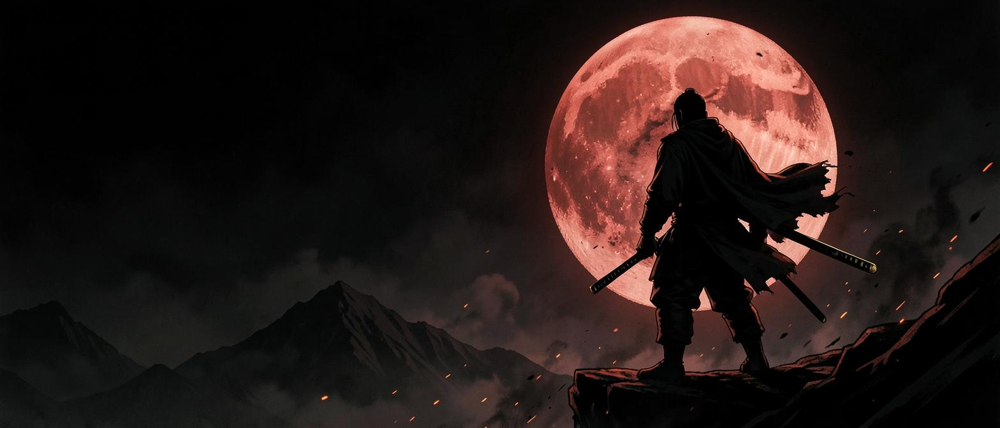

<!-- ═══════════════════════════════════════════════════════════════════════════
     T H E   L A S T   R O N I N   ·   wawazer
     "A blade unused grows dull. A mind unused grows the same."
     ═══════════════════════════════════════════════════════════════════════════ -->

  

 

<samp>「 侍 — 一人の浪人、一本の刀、果てしない道 」</samp>

 

<i>One ronin. One blade. An endless road.</i>

  

 

 

<!-- ─────────────────────────── 第 一 章 ─────────────────────────── -->

## 🏯 第一章 — THE RONIN

> *A samurai without a master is not without a purpose.*

I am **Muhammad Zen Wawazer** — a digital craftsman wandering the borderlands between design and technology.

The old masters spoke of **shokunin**, the artisan's spirit: a lifelong devotion to the craft itself, never to the applause. I hold to that. Every interface is a stroke of the brush. Every system is a kata, repeated until it becomes instinct. Nothing shipped is ever finished — only sharpened.

I build thoughtful digital experiences through design that respects the people who use it, and code that respects the people who maintain it.

 

<!-- ─────────────────────────── 第 二 章 ─────────────────────────── -->

## ⚔️ 第二章 — THE PATH

| 道 · The Road | 修行 · The Pursuit |
|:---|:---|
| 🎴 **Craft** | UI/UX Designer & Frontend Developer |
| 🏯 **Domain** | PT Pelindo · Freelance |
| 🗡️ **Training** | React.js · Flutter · Node.js |
| 🎨 **Focus** | Digital Product Design |
| 📜 **Code of Honor** | Open Source & Clean Architecture |
| 🌙 **Hours** | Late. Always late. |

 

<b>&nbsp;◈&nbsp; READ THE SCROLL — the journey so far</b>

 

- **I.** Shaping digital experiences that put people before pixels.
- **II.** Turning half-formed ideas into interfaces that feel inevitable.
- **III.** Hunting new technologies the way a swordsman hunts better form.
- **IV.** Sharpening real-world systems at **PT Pelindo**.
- **V.** Learning, breaking, rebuilding — the only loop that matters.

 

<!-- ─────────────────────────── 第 三 章 ─────────────────────────── -->

## 🥷 第三章 — THE ART OF WAR

<table width="100%">
<tr>
<td align="center" width="33%">
<h3>01 — 規律</h3>
<b>DISCIPLINE</b>  
Consistency outlasts motivation. Show up on the days the fire is gone.
</td>
<td align="center" width="33%">
<h3>02 — 精密</h3>
<b>PRECISION</b>  
Every detail is a decision. Every decision has a reason.
</td>
<td align="center" width="33%">
<h3>03 — 創造</h3>
<b>CREATION</b>  
Technology is the blade. Creativity is the hand that wields it.
</td>
</tr>
</table>

 

<!-- ─────────────────────────── 第 四 章 ─────────────────────────── -->

## 🗡️ 第四章 — THE ARSENAL

 

**刃 — The Blade** &nbsp;·&nbsp; *interface & motion*

  

**炉 — The Forge** &nbsp;·&nbsp; *systems & data*

 

<!-- ─────────────────────────── 第 五 章 ─────────────────────────── -->

## 📊 第五章 — BATTLE RECORDS

 

 

 

 

<samp>「 千日の稽古を鍛とし、万日の稽古を練とす 」</samp>

 

<i>a thousand days of training to forge · ten thousand days of training to polish</i>

 

<!-- ─────────────────────────── 第 六 章 ─────────────────────────── -->

## 📜 第六章 — BUSHIDO

### 武士道 — THE SEVEN VIRTUES

| 徳 | Virtue | Principle |
|:---:|:---|:---|
| **義** | *Gi* — Righteousness | Stand for what is right, especially when it costs you. |
| **勇** | *Yu* — Courage | Face every challenge. Fear is a compass, not a wall. |
| **仁** | *Jin* — Benevolence | Build for people, not for metrics. |
| **礼** | *Rei* — Respect | Honor every collaboration. Leave the code kinder than you found it. |
| **誠** | *Makoto* — Honesty | Say what you mean. Ship what you promise. |
| **名誉** | *Meiyo* — Honor | Protect your integrity. It is the only sword that never breaks. |
| **忠義** | *Chūgi* — Loyalty | Stay committed to the craft, long after the novelty fades. |

 

<!-- ─────────────────────────── 終 章 ─────────────────────────── -->

  

<samp>七 転 び 八 起 き</samp>

 

<i>Fall seven times. Rise eight.</i>

   

 

KEEP LEARNING · KEEP BUILDING · KEEP MOVING

  

