<!-- ═══════════════════════════════════════════════════════════════════════════
     O R B I T A L   ·   wawazer
     "We are all made of star stuff — but the code is still ours to write."
     ═══════════════════════════════════════════════════════════════════════════ -->

<div align="center">



<br/><br/>

<a href="https://git.io/typing-svg">
  
</a>

<br/>

<samp>「 星 の 海 を 渡 る 」</samp>

<br/>

<i>A wanderer, crossing the sea of stars.</i>

<br/><br/>

<a href="https://www.linkedin.com/in/muhammad-zen-wawazer-131b8582/">
  
</a>
<a href="https://www.instagram.com/zenwawazer/">
  
</a>
<a href="mailto:wawazer@gmail.com">
  
</a>


<br/><br/>

<a href="#console"><kbd>&nbsp;Console&nbsp;</kbd></a>
<a href="#star-chart"><kbd>&nbsp;Star Chart&nbsp;</kbd></a>
<a href="#constellation"><kbd>&nbsp;Constellation&nbsp;</kbd></a>
<a href="#expedition"><kbd>&nbsp;Expedition&nbsp;</kbd></a>
<a href="#workspace"><kbd>&nbsp;Workspace&nbsp;</kbd></a>
<a href="#logs"><kbd>&nbsp;Logs&nbsp;</kbd></a>
<a href="#signal"><kbd>&nbsp;Signal&nbsp;</kbd></a>

<br/><br/>


<br/>



</div>

<br/>

<a id="console"></a>

## Mission Console

<div align="center">



<br/><br/>

**Hello, universe. 👋**

I'm **Muhammad Zen Wawazer** — a designer and frontend developer who treats the browser like a small spacecraft: every layout is a flight plan, every interaction is a manoeuvre, and every release is a launch window.

I care about interfaces that feel calm under pressure, and code that another engineer can read at 2 a.m. without cursing my name. Design is not decoration here; it is navigation.

<br/>

<sub>**CURRENT ORBIT** &nbsp;·&nbsp; designing digital products &nbsp;·&nbsp; building frontends &nbsp;·&nbsp; learning the backend sky</sub>

</div>

<br/>


<br/>

<a id="star-chart"></a>

## Star Chart

<div align="center">

*Everything I use to navigate.*

<br/>

**◆ &nbsp;CORE&nbsp;·&nbsp;the engines**


<br/><br/>

**◆ &nbsp;INTERFACE&nbsp;·&nbsp;the cockpit**


<br/><br/>

**◆ &nbsp;SYSTEMS&nbsp;·&nbsp;the hull**


<br/><br/>

**◆ &nbsp;DRIFT&nbsp;·&nbsp;the instruments**


</div>

<br/>


<br/>

<a id="constellation"></a>

## Constellation

<div align="center">

*Thirteen stars, one sky. Each one earned, not granted.*

<br/>



</div>

<br/>


<br/>

<a id="expedition"></a>

## The Expedition

<div align="center">



<br/><br/>

**Next destinations**


<br/><br/>

<sub>`compute` launch a real deployment pipeline &nbsp;·&nbsp; `payload` test infrastructure that never breaks twice &nbsp;·&nbsp; `signal` learn observability before it learns me</sub>

</div>

<br/>


<br/>

<a id="workspace"></a>

## Inside the Workspace

<div align="center">

*Where the ship gets built: one commit at a time, mostly at night.*

<br/>

**PLAN → DESIGN → BUILD → BREAK → DEBUG → SHIP**

<br/><br/>

```text
wawazer/
├── ⌁ design/            figma frames · design tokens · prototypes
├── ⌁ frontend/          react · next.js · tailwind · animation
├── ⌁ mobile/            flutter experiments
├── ⌁ backend/           node · express · laravel · rest apis
├── ⌁ data/              mysql · mongodb · firebase
├── ⌁ ops/               git · docker · ci/cd (in progress)
└── ⌁ labs/              half-finished ideas, kept on purpose
```

<br/>

<sub>Rules of the ship: name things honestly · leave the campfire cleaner than you found it · ship small, ship often.</sub>

</div>

<br/>


<br/>

<a id="logs"></a>

## Mission Logs

<div align="center">

*Telemetry from the last few years in orbit.*

<br/>


<br/><br/>


<br/><br/>


<br/>

<samp>「 上 を 見 ろ 。星 は そ こ に あ る 」</samp>

<br/>

<i>Look up. The stars are right there.</i>

</div>

<br/>


<br/>

<a id="signal"></a>

## Open Frequency

<div align="center">

<table width="86%">
<tr>
<td align="center">

### Signal Received?

Good work rarely happens alone. If you're building something that deserves a better interface — or a frontend that doesn't fall apart at the seams — my channel is open.

<br/>

`Open Source` &nbsp;·&nbsp; `Product Design` &nbsp;·&nbsp; `Frontend` &nbsp;·&nbsp; `Collaboration`

<br/><br/>

<a href="mailto:wawazer@gmail.com">
  
</a>

<br/><br/>

<a href="https://github.com/wawazer"></a>
&nbsp;
<a href="https://www.linkedin.com/in/muhammad-zen-wawazer-131b8582/"></a>
&nbsp;
<a href="https://www.instagram.com/zenwawazer/"></a>
&nbsp;
<a href="mailto:wawazer@gmail.com"></a>

</td>
</tr>
</table>

<br/>


<br/><br/>



</div>
